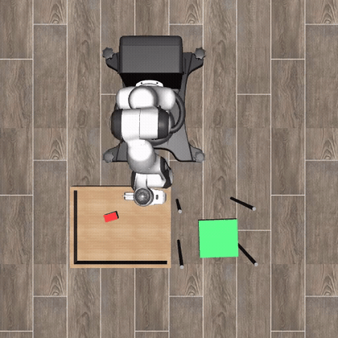
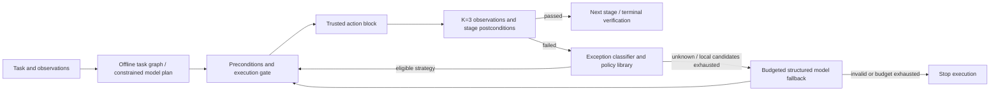

<div align="center">

# HARP
### Hierarchical Agent for Recovery and Planning

**Robotic task planning · Controlled execution · K=3 verification · Exception recovery**

[中文介绍](README.zh-CN.md) · [Results & evidence](docs/RESULTS.md) · [Reproduce](docs/REPRODUCING.md) · [Code map](docs/CODE_MAP.md)

</div>

HARP extends **CaP-X** with hierarchical execution, offline task graphs, a parameterized recovery library, and constrained model planning. Known failures reuse local strategies; unknown failures enter a bounded model fallback. Each action stage must satisfy its postconditions before the robot proceeds.

## Watch HARP

<table>
<tr><th>Policy-first exception recovery</th><th>L4 structured skill-graph execution</th></tr>
<tr>
<td><a href="assets/videos/known-policy-recovery.mp4"></a></td>
<td><a href="assets/videos/l4-structured-plan.mp4"></a></td>
</tr>
<tr>
<td>Bin placement, <code>unstable_release</code>, hybrid seed 6.<br>Saved-code replay, shown at the archived video frame rate.</td>
<td>Region placement, seed 301, <code>TARGET_POSITION_CHANGED</code>.<br>Recorded execution; preview slowed 2× for readability.</td>
</tr>
</table>

[Download recovery MP4](assets/videos/known-policy-recovery.mp4) · [Download baseline replay MP4](assets/videos/model-driven-baseline.mp4) · [Download L4 MP4](assets/videos/l4-structured-plan.mp4) · [Video provenance](assets/videos/provenance.json)

The GIFs play directly on this page. Videos use accelerated simulation capture, rather than real-time wall-clock recording.

## Execution architecture



- **Offline recovery:** parameter binding from current object and target observations; preconditions and postconditions accompany each strategy.
- **Constrained planning:** L4 accepts a `recovery_graph_v1` object. The local compiler owns robot-control code and validates skill order, object roles and discrete parameters.
- **Stage verification:** three fresh observations check consistency and the required action outcome. Grasp verification gates placement; terminal physical truth is retained for evaluation.
- **Bounded execution:** request limits, loop guards, candidate limits and explicit stop paths prevent uncontrolled recovery loops.

The L1–L4 names describe scheduling and model-authority variants. Configuration files are the executable definitions; the historical known-anomaly experiment and the L4 smoke test use different variants and models.

## Published results

### Known-anomaly bin-placement experiment

Three configured scenarios × ten seeds × two methods, using `google/gemini-3.8-flash`.

| Method | Completed tasks | Completion rate | Model requests | Total tokens | Mean trial wall time |
|---|---:|---:|---:|---:|---:|
| Policy-first hybrid | **28/30** | **93.3%** | 24 | 97,985 | 12.47 s |
| Model-driven CAPX control | 12/30 | 40.0% | 201 | 1,280,203 | 198.47 s |

Observed end-to-end completion difference: **+53.3 percentage points**. The saved object-initial-state fingerprints match in all 30 pairs. Actual recorded injection exposure differs: **21/30** hybrid and **13/30** native, with **13/30** pairs recording injection on both sides. These numbers describe end-to-end runs under the configured conditions. Read the per-scenario coverage alongside the aggregate results.

### L4 structured-planning smoke test

`region_place`, seed **301**, `TARGET_POSITION_CHANGED`, `gpt-6-astra`: **1/1 physical success**, **one valid-trial request**, **11,052 tokens**, **12.60 s** model response and **37.31 s** trial wall time. An earlier format-rejected preflight used another **10,982 tokens**; both requests total **22,034 tokens**. A same-model baseline is pending.

[Read the full evidence summary](docs/RESULTS.md) · [Known A/B table](results/known_ab_20260921/results.json) · [Fault coverage](results/known_ab_20260921/fault_coverage.json)

## Verify the archived results

The audit uses only the Python standard library and the bundled evidence. It makes no model or simulator calls.

```bash
git clone https://github.com/ystz00jjjr-byyz/HARP-Hierarchical-Agent-for-Recovery-and-Planning.git
cd HARP-Hierarchical-Agent-for-Recovery-and-Planning
python3 scripts/audit_published_results.py
```

Expected output includes `hybrid 28/30; native 12/30`, recorded dual-injection counts `6, 7, 0`, and a physically successful L4 terminal record.

## Run and explore

- [Installation, optional services and experiment commands](docs/REPRODUCING.md)
- [HARP modules, configuration variants and tests](docs/CODE_MAP.md)
- [Offline task graph and structured recovery guide](docs/offline_recovery.md)
- [Source snapshot and original file hashes](SOURCE_SNAPSHOT.json)

HARP retains the `capx` Python package namespace to reuse the original environment and integration interfaces. This repository exports HARP's current runtime source, selected configurations, tests, compressed trial trajectories, model responses, metrics and representative videos. Dependency sources remain pinned Git submodules.

## Acknowledgements and license

Built on [CaP-X](https://github.com/capgym/cap-x), with its upstream MIT license and attribution retained in [LICENSE](LICENSE) and the [upstream README](docs/UPSTREAM_README.md). Third-party dependencies retain their own licenses. Historical experiment artifacts carry their original provenance; the current source export is versioned independently.
