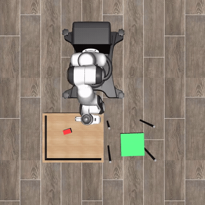

# HARP：机器人分层规划与异常恢复系统

**Hierarchical Agent for Recovery and Planning**

[English](README.md) · [实验结果](docs/RESULTS.md) · [安装与复核](docs/REPRODUCING.md) · [代码索引](docs/CODE_MAP.md)

HARP 基于 CaP-X，将离线任务图、参数化异常策略库与结构化模型规划接入统一执行流程，形成“任务规划—受控执行—状态验证—异常恢复”的闭环。抓取落空、放置偏移等已知异常优先复用本地策略；策略未命中或执行失败后，在预算内请求模型生成受约束的恢复方案。

## 演示

### 策略优先异常恢复

[](assets/videos/known-policy-recovery.mp4)

箱内放置 `unstable_release` 场景，hybrid seed 6。视频是已归档控制代码的仿真回放。另提供[原生组相同 seed 的回放](assets/videos/model-driven-baseline.mp4)。

### L4 结构化技能图

[](assets/videos/l4-structured-plan.mp4)

区域放置 seed 301，`TARGET_POSITION_CHANGED`，来自实际 L4 单试次录像；GIF 放慢两倍便于观看。[视频来源与哈希](assets/videos/provenance.json)。

## 核心实现

- **分层执行**：L1–L4 协调离线控制、受控模板和技能图规划，具体模型权限由 YAML 配置定义。
- **异常策略库**：按当前物体位姿、尺寸与目标区域绑定参数，执行重观测、重抓及重新放置。
- **结构化规划**：验证 `recovery_graph_v1` 的字段、技能顺序和离散参数，由本地编译器生成可信控制代码。
- **阶段验证**：每段动作后重新采集 K=3 状态，检查观测一致性和后置条件，抓取通过后才进入放置。
- **预算与停止**：限制模型请求、候选和重复失败次数，预算耗尽或条件不满足时停止执行。

## 结果

| 实验 | 方法 | 完成情况 |
|---|---|---:|
| 已知异常 bin_place，Gemini，30 对试次 | 策略优先混合版 | **28/30** |
| 同批配置对照 | 模型驱动 CAPX | **12/30** |
| L4 区域放置，Astra，seed 301 | 结构化技能图 | **1/1 物理成功** |

已知异常试验的端到端完成率差为 **53.3 个百分点**。两组物体初态指纹匹配，实际注入记录覆盖为 hybrid 21/30、native 13/30，双方均记录注入为 13 对。L4 为独立单试次，保留其格式失败预检记录和开销。

## 一条命令复核

```bash
python3 scripts/audit_published_results.py
```

复核程序读取归档表、60 条压缩轨迹和 L4 终态证据，在本地重算成功数量、故障覆盖及用量，无需模型服务。

项目使用原有 `capx` 包名。环境与控制接口来自 CaP-X，MIT 许可证和上游署名完整保留。安装、依赖、模型权重与实验入口见[复现指南](docs/REPRODUCING.md)。
